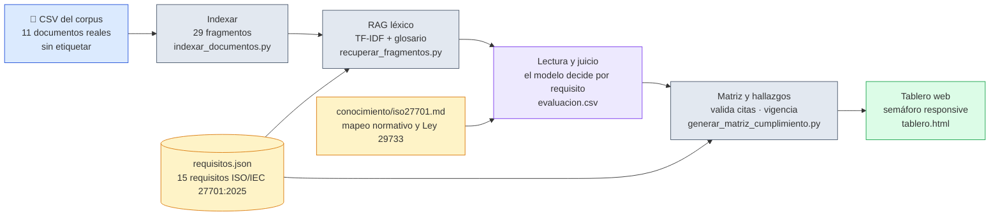
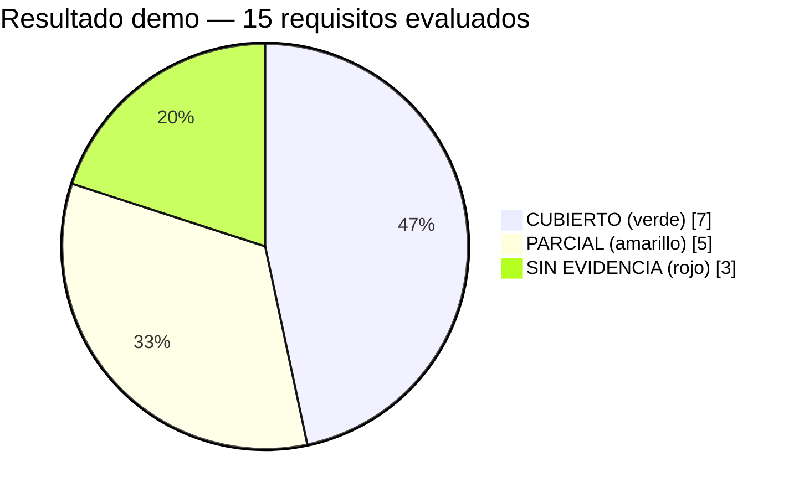

# TIF – Auditoría de Sistemas · Grupo 6


**Agente de cumplimiento PIMS** — skill y asistente de IA que reciben el
corpus documental real de una organización (políticas, procedimientos,
registros, contratos, capacitaciones — sin etiquetar contra la norma),
recuperan por **RAG** (indexado + recuperación léxica TF-IDF) los fragmentos
relevantes para cada requisito y **leen su contenido** para decidir qué
requisitos del PIMS (ISO/IEC 27701:2025) están cubiertos, cuáles parcialmente
y cuáles sin evidencia, con el respaldo de ISO/IEC 27001:2022, 27002:2022,
29100, ISO 19011 y la Ley N.° 29733. El checklist de requisitos, el mapeo de
controles (verificado contra la edición 2 de 27701, octubre 2025) y el proceso
de auditoría por fases están en
`.claude/skills/verificador-cumplimiento-pims/conocimiento/iso27701.md`.

## Cómo trabaja el agente



El paso violeta (la lectura) **no es determinista a propósito**: es el juicio
del modelo sobre lo que dice el texto, citando el `chunk_id` exacto. Los
demás pasos son scripts deterministas con solo la librería estándar de Python.
La matriz **rechaza citas inventadas**: todo `chunk_id` debe existir en el
índice y todo veredicto CUBIERTO/PARCIAL debe citar al menos un fragmento.

## Primer entregable: skill funcional especializado

| Tarea del entregable | Dónde está |
|---|---|
| De Prompt a Skill — transformación de la tarea en un proceso reutilizable | `entregable-1/01-de-prompt-a-skill.md` |
| Creación de Skill — activación, estructura y pasos | `entregable-1/02-creacion-de-skill.md` y el skill en `.claude/skills/verificador-cumplimiento-pims/` |
| Construcción de Asistente — identidad, instrucciones y conocimiento | `entregable-1/03-construccion-de-asistente.md` y el asistente en `.claude/agents/auditor-cumplimiento-pims.md` |
| Resultado: skill funcional | `entregable-1/demo/` (datos de prueba, tablero y salida generada) e `entregable-1/Informe_Entregable1_Grupo6.docx` |

## Estructura

```
TIF/
├── .claude/
│   ├── skills/verificador-cumplimiento-pims/  <- el skill (SKILL.md, requisitos.json, scripts/, plantillas/, conocimiento/)
│   └── agents/auditor-cumplimiento-pims.md    <- el asistente AuditorPIMS
├── entregable-1/
│   ├── 01-de-prompt-a-skill.md
│   ├── 02-creacion-de-skill.md                <- incluye métricas de recuperación (sección 4.1)
│   ├── 03-construccion-de-asistente.md
│   ├── demo.ps1 / demo.sh                     <- reproduce la demostración (RAG + tablero)
│   ├── Informe_Entregable1_Grupo6.docx        <- informe del entregable
│   ├── Diapositivas_Avance_Grupo6.pptx        <- presentación de avance
│   └── demo/
│       ├── documentos_empresa_demo.csv        <- 11 documentos reales de la empresa demo (sin clasificar)
│       ├── indice_chunks.json                 <- 29 fragmentos indexados (RAG paso 1)
│       ├── fragmentos_recuperados.json        <- fragmentos recuperados por requisito (RAG paso 2)
│       ├── evaluacion_demo.csv                <- veredicto de referencia (lectura ya hecha por el asistente)
│       └── salida/                            <- resumen.json + hallazgo_<REQ-ID>.md + tablero.html
├── instrucciones/                             <- enunciado del TIF y tema asignado
├── tests/test_pipeline.py                     <- 24 pruebas con unittest (solo stdlib)
├── LICENSE                                    <- MIT
└── README.md
```

## La demo en números



| Estado | Semáforo | Requisitos |
|---|---|---|
| CUBIERTO | 🟩 | REQ-01, 04, 06, 09, 10, 14, 15 |
| PARCIAL | 🟨 | REQ-03, 05, 07, 11, 12 |
| SIN EVIDENCIA | 🟥 | REQ-02 (PIA), REQ-08 (análisis de accesos), REQ-13 (auditoría interna) |

Calidad de la recuperación RAG medida contra el *ground truth* de la demo
(detalle en `entregable-1/02-creacion-de-skill.md`, sección 4.1):

| Métrica | Valor | Significado |
|---|---|---|
| Recall | **100%** (12/12) | La evidencia que hace falta nunca se pierde de la recuperación |
| Precisión | **29%** (12/42) | Se recupera ruido a propósito: la lectura del modelo lo filtra |

## Cómo demostrarlo

Requisito: Python 3.8 o superior (**sin dependencias externas**).

```powershell
cd entregable-1
.\demo.ps1          # Windows
# ./demo.sh         # Linux / macOS
```

Esto genera el corpus de 11 documentos, lo indexa, recupera por RAG los
fragmentos relevantes para cada uno de los 15 requisitos, aplica la evaluación
de referencia (la lectura que ya hizo el asistente sobre ese contenido),
**valida cada cita contra el índice** y genera la matriz, los hallazgos y el
tablero web. Abrir `entregable-1/demo/salida/tablero.html` en el navegador
para ver el semáforo, o servirlo como app local:

```powershell
python .claude/skills/verificador-cumplimiento-pims/scripts/servir_tablero.py --carpeta entregable-1/demo/salida --solo-tablero
```

Resultado esperado: 11 documentos, 15 requisitos evaluados — **7 CUBIERTO**,
**5 PARCIAL**, **3 SIN_EVIDENCIA** — y 2 documentos no citados por ningún
requisito (no tratan protección de datos personales). La matriz además
advertirá 2 evidencias con fecha posiblemente vencida (el RAT de dic-2025 y
el registro de incidentes dentro del procedimiento de sept-2025): es el
control de `vigencia_max_dias` funcionando, no un cambio de veredicto.

## Verificación automática

```powershell
python -m unittest discover -s tests -v
```

24 pruebas de la librería estándar cubren: troceo con saltos Windows (CRLF) y
CSV con BOM, errores claros ante entradas inválidas, rechazo de `chunk_id`
inventados, control de vigencia, prioridad parametrizable, y la demo completa
end-to-end (11 documentos → 29 fragmentos → 7/5/3 → tablero responsive).

## Con el asistente (Claude Code) sobre documentos nuevos

Abrir Claude Code en la carpeta `TIF/` y escribir, por ejemplo:

```
Aquí están nuestros documentos (ruta al CSV). ¿Cumplimos con la 27701?
```

El asistente `auditor-cumplimiento-pims` indexa, recupera por RAG, **lee el
contenido real** de cada documento recuperado y decide — citando el texto —
si cada requisito está cubierto. También se puede invocar directamente con
`/verificador-cumplimiento-pims`.

## Con documentos propios

Arma un CSV con columnas
`id_documento, tipo, fecha_documento, responsable, ubicacion, contenido`
(párrafos separados por línea en blanco; ver `SKILL.md`). Acepta saltos de
línea Windows/Unix y CSV con BOM; si viene de Excel en ANSI, usa
`--encoding cp1252`. Para otra institución o checklist, copiar
`requisitos.json`, ajustar requisitos, vigencias y criticidad, y pasar la
copia con `--requisitos`.

## Escenario sembrado en la demo

Huecos intencionales **dentro de documentos reales** (no documentos enteros
ausentes o mal etiquetados) — el patrón que pidió la cátedra para que la
demo sea convincente:

| Requisito | Documento | Estado | Por qué |
|---|---|---|---|
| REQ-03 | RAT (`DOC-02`) | PARCIAL | El propio registro reconoce que no incluye los convenios de 2026 |
| REQ-05 | Política de privacidad (`DOC-01`) | PARCIAL | Declara los derechos ARCO pero no define el procedimiento operativo |
| REQ-07 | Manual de accesos (`DOC-04`) | PARCIAL | Exige contraseña robusta pero no contempla autenticación multifactor |
| REQ-11 | Plan de capacitación (`DOC-07`) | PARCIAL | No cubre protección de datos ni registra ejecución |
| REQ-12 | Contrato con proveedor de nube (`DOC-06`) | PARCIAL | No incluye cláusula de confidencialidad ni de protección de datos |
| REQ-02, REQ-08, REQ-13 | — | SIN EVIDENCIA | Ningún documento del corpus trata PIA, análisis de accesos ni auditoría interna |

Los 7 requisitos restantes tienen evidencia que, al leerla, sí satisface lo
exigido. Además, 2 documentos reales de la institución (política de
teletrabajo, reporte de satisfacción del cliente) no son citados por ningún
requisito — el asistente verifica que no corresponden a privacidad en vez de
forzarlos a encajar en algo.

## Alcance

El **entregable 1** está completo y endurecido: validación de citas contra el
índice, control de vigencia, tablero responsive con columna de advertencias,
24 pruebas automáticas, licencias y numeración normativa verificada contra
ISO/IEC 27701:2025 edición 2. El **entregable 2** (diseño de agente,
orquestación y proyecto agéntico) es la siguiente fase del curso.
